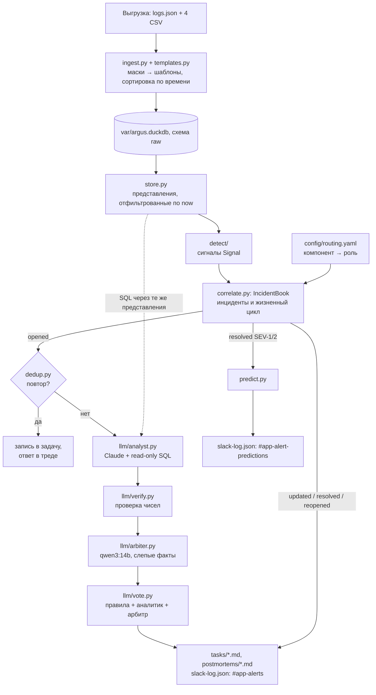
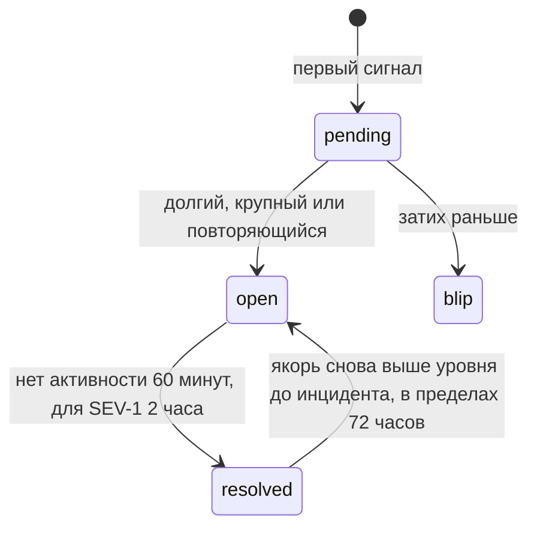

# Архитектура Argus

Для кого: SRE, который будет сопровождать систему, и ревьюер.
Коротко: статистика находит и группирует аномалии, LLM-агент пишет разбор, код проверяет каждое число,
модель другого семейства голосует за исполнителя. Любой сбой модели не теряет алерт: остаётся разбор по правилам.

## 1. Конвейер

Всё от `detect/` до выходов — один вызов `Engine.tick(now)` в `src/argus/engine.py`. Тик — одна
десятиминутная корзина.

## 2. Этапы и модули

| Этап | Модуль | Что делает |
|---|---|---|
| Загрузка | `ingest.py`, `templates.py` | выгрузка → `var/argus.duckdb`; 6 масок, 443 шаблона; `undefined` отбрасывается |
| Хранилище | `store.py` | представления только для чтения, отфильтрованные по `now` |
| Детекторы | `detect/baseline.py`, `logs.py`, `metrics.py`, `countries.py` | сигналы `log_burst` (новый шаблон — атрибут `new_signature`), `rps_artifact`, `rps_shift`, `cpu_high`, `traffic_shift`, `country_shift` |
| Признаки бота | `detect/security.py` | доля провайдера и ротация IP в окне инцидента |
| Маршрутизация | `routing.py`, `config/routing.yaml` | шаблон или вид метрики → компонент → роль, семейство, причина или симптом |
| Корреляция | `correlate.py`, `probe.py` | сигналы → инциденты; влияние (клиенты, строки, пиковая доля ошибок), severity, жизненный цикл |
| Движок | `engine.py` | тики, задачи, Slack, прогнозы, состояние |
| Пакет фактов | `evidence.py` | всё, что код знает об инциденте на момент `now`, не больше 10 КБ |
| LLM | `llm/analyst.py`, `tools.py`, `verify.py`, `arbiter.py`, `vote.py` | разбор, SQL-инструмент, проверка чисел, второе мнение, голосование |
| Повторы, прогнозы | `dedup.py`, `predict.py` | поиск повтора до создания задачи; прогноз повтора |
| Вывод | `tracker.py`, `render/task.py`, `render/slack.py`, `render/templates/*.j2` | задачи, постмортемы, Block Kit |
| Оценка, отчёт | `evals.py`, `report.py` | `make eval`, `report.html` |
| Для агентов | `mcp_server.py` | `argus mcp`: инструменты `sql`, `schema`, `list_tasks`, `get_task` |

## 3. Без заглядывания в будущее

- `store.py` создаёт представления поверх `raw.*` с фильтром `getvariable('argus_now')`. Строки логов —
  `ts < now`. Корзины и точки метрик — `<= now`, потому что метка корзины — конец окна. Шаблоны — только
  уже появившиеся.
- Детекторы используют только прошлые корзины: `shift(k>0)` и хвостовые окна.
- SQL-инструмент аналитика читает те же представления. Белый список проверяется по дереву разбора DuckDB
  (`json_serialize_sql`) до раскрытия представлений, поэтому запрос к `raw.logs` не пройдёт.
- В replay детекторы считаются один раз по всему диапазону, а движок выдаёт сигналы по времени
  обнаружения. Тест `tests/test_engine.py::test_replay_has_no_lookahead` проверяет, что это равно живому прогону.

## 4. Жизненный цикл инцидента

| Переход | Условие (`config/argus.yaml`, раздел `incidents`) |
|---|---|
| pending → open | через одну корзину после появления, если: не меньше 2 корзин и 1000 клиентов; или 5000 клиентов в одной корзине; или третий блип с тем же отпечатком за 24 часа. Корзина ожидания нужна, чтобы успел прийти сигнал-причина: в G1 таймауты REST пришли в 11:30, `LOADING` от Valkey — в 11:40 |
| pending → blip | короткий всплеск с малым влиянием. Задачи нет, только счётчик |
| open → resolved | 6 тихих корзин; для SEV-1 — 12. Для стран — 36 корзин, для качества данных — 288 |
| долгая регрессия | инцидент дольше 6 часов, который ведёт шаблон-причина, открыт, пока якорь выше уровня до инцидента (`docs/analysis.md`, п. 5) |
| resolved → open | якорь снова вырос в течение 72 часов: событие `reopened`, тот же инцидент и та же задача |
| эскалация | severity стала выше, чем у задачи: ответ в треде с показом в канале; для повтора ещё и новый разбор LLM (текст задачи описывает первый, более мягкий случай) |
| переназначение | к инциденту из одних симптомов пришла причина: новый разбор под нового владельца |

| Severity | Условие |
|---|---|
| SEV-1 | пиковая доля ошибок за 10 минут ≥ 1 %, или ≥ 500 000 клиентов |
| SEV-2 | пик ≥ 0,1 %, или ≥ 50 000 клиентов, или дольше 60 минут и ≥ 5000 клиентов, или CPU ≥ 85 % (само насыщение без ошибок выше SEV-2 не поднимает) |
| SEV-3 | остальное; бот (`abuse`) — не ниже SEV-2 |

## 5. Разделы: ops, seo, data_quality

Инциденты живут в трёх независимых разделах, чтобы проблема одного вида не поглощала другую.

| Раздел | Что туда попадает | Особенности |
|---|---|---|
| `ops` | кэш, БД, сеть, код, внутренние API, нагрузка, бот | правила склейки ниже |
| `seo` | `country_shift` | падение трафика страны во время открытого SEV-1/2 — симптом сбоя, оно уходит в `ops` |
| `data_quality` | `rps_artifact` | один открытый инцидент собирает все артефакты (`dq_open_count` = 3), дежурного не будит |

Склейка в `ops`:
- сигнал присоединяется к активному инциденту своего семейства (кэш и БД — одно семейство `data_store`);
- симптом (таймауты, 5xx) или ошибка кода присоединяется к активному инциденту с самым высоким приоритетом
  семейства: `data_store` 5, `infra` 4, `app` 3, `upstream` 2, `capacity` 1;
- причина присоединяется к инциденту, где пока только симптомы: она их объясняет;
- другая причина открывает свой инцидент: сбой DNS во время отказа БД — отдельная задача.

## 6. Маршрутизация и голосование

Правила: шаблон проверяется регулярными выражениями из `config/routing.yaml`, первое совпадение задаёт
компонент; без совпадения — `app_errors`. Метрики идут через `metric_components`. Особые случаи:
только таймауты внутренних API при росте нагрузки (рост RPS или `cpu_high`) — PaaS Engineer, без нагрузки —
Backend Lead; признаки бота переводят инцидент в `abuse` (Security Lead).

Аналитик — Claude (`claude-opus-5-5`, effort medium) через Claude Agent SDK. Единственный инструмент —
SQL в том же процессе: один SELECT, белый список представлений, до 50 строк. Встроенных инструментов,
пользовательских настроек и навыков нет (`tools=[]`, `setting_sources=[]`, `skills=[]`). Ответ — по JSON-схеме,
до 10 ходов и до $2 на инцидент. Каждое число в тексте код сверяет с пакетом фактов и результатами SQL агента.
Непроверенные числа дают один ход на исправление в той же сессии; остаток перечисляется в задаче
(`verification: partial`).

Арбитр — `qwen3:14b` в Ollama. Он видит «слепой» пакет фактов: без мнения правил и без текста аналитика.

| Голоса | Исполнитель | `needs-human` |
|---|---|---|
| двое из трёх согласны | большинство | нет |
| все разошлись (или аналитик против правил без арбитра) | выбор аналитика | да |
| правила опираются на шаблон-причину, которого раньше не было, а модели против | выбор правил | да |
| арбитр считает, что это не аномалия | по голосованию | да |

## 7. Повторы и прогнозы

**Повторы** (`dedup.py`) проверяются до вызова LLM, поэтому повтор не стоит ничего.
Кандидаты — задачи того же компонента или того же семейства со слиянием, активные за последние 72 часа.
Совпадение: Jaccard шаблонов-причин ≥ 0,34, или косинус эмбеддингов ≥ 0,85, или главный шаблон-причина
нового инцидента уже есть в задаче. Эмбеддинги — `qwen3-embedding:0.6b` в Ollama, без Ollama —
хэшированные символьные триграммы. Шаблон-причина, которого раньше не было, означает новый режим отказа:
это новая задача. Повтор пишется в историю задачи и в тред. Если повтор тяжелее задачи, его разбирают заново.

**Прогнозы** (`predict.py`). После закрытия SEV-1/2 из семейства `data_store` Argus строит прогноз RPS
на 24 часа по медианам того же времени суток прошлых дней. Предупреждение уходит, если прогноз вернётся
к уровню RPS, при котором инцидент начался, не раньше чем через час; окно риска начинается за 60 минут
до этого. Условия: инцидент начался выше медианы RPS за сутки; не чаще раза в сутки на задачу.
Почему повтор, а не общий прогноз тренда: оба сбоя хранилищ вернулись на следующем утреннем росте
(Valkey 02.09 → 03.09, MongoDB 25.08 → 26.08). DNS и конфигурация за трафиком не следуют.

## 8. Выходы

**Задача** — `tasks/ARG-NNN-<компонент>-<ГГГГММДД-ЧЧММ>.md`. Поля front matter:

| Поле | Смысл |
|---|---|
| `id`, `title`, `component` | номер, заголовок, компонент из `routing.yaml` |
| `assignee`, `severity`, `status` | исполнитель после голосования, SEV-1…3, статус |
| `labels` | `argus`, компонент, severity, `needs-human`, `recurring` |
| `started_at`, `detected_at`, `resolved_at`, `time_to_detect_min` | хронология и время до алерта |
| `affected_clients`, `peak_error_rate` | различные `user_id`/IP (нижняя оценка) и пиковая доля ошибок |
| `fingerprint`, `votes` | отпечаток для повторов, голоса правил, аналитика и арбитра |
| `analysis`, `verification` | источник разбора и модель; `ok` или `partial` |
| `postmortem` | путь к черновику постмортема |

Тело на русском, разделы: «Что происходит», «Симптомы», «Возможные причины», «Затронутые пользователи»,
«Почему <исполнитель>», «Что проверить в первую очередь», «Повторы», «Данные», «История».

**Постмортем** — `postmortems/<то же имя>.md`: хронология из ключевых сигналов и истории задачи, время
до алерта, длительность, разбор. Дописать его помогает навык `.claude/skills/investigate-incident`.

**Slack** — `slack-log.json`, массив записей `{ts, method, payload, meta}`. `method` — `chat.postMessage`
или `chat.update`, `payload` — ровно то, что ушло бы в Slack Web API (Block Kit).
- Открытие — корневое сообщение в `#app-alerts` с упоминанием дежурного роли (`slack.mentions`) и ссылкой на задачу.
- Обновления, повторы, закрытие, возобновление — ответы в треде (`thread_ts`). Корневое сообщение
  переписывается через `chat.update`, чтобы статус был виден без открытия треда.
- Эскалация — ответ в треде с `reply_broadcast: true`.
- Прогноз — сообщение в `#app-alert-predictions` и строка в задаче.

## 9. Состояние и идемпотентность

- Курсор, инциденты, записи задач и прогнозы хранятся в `<out>/.argus/state.pkl`, сводка для человека —
  в `<out>/.argus/state.json`. Состояние лежит рядом с выходами, которые оно описывает.
- Каждый проход обрабатывает корзины после курсора. Повторный запуск не создаёт задачи и сообщения второй раз.
- `argus replay --fresh` удаляет состояние и сгенерированные файлы, только те пути, которые пишет Argus.
- В Kubernetes `concurrencyPolicy: Forbid` не даёт двум проходам писать одновременно.

## 10. Режимы и развёртывание

| Режим | Команда | Когда |
|---|---|---|
| replay | `argus replay --fresh [--llm off]` (`make replay`, `make replay-offline`) | вся история на «живых» часах; меряет время до алерта |
| run | `argus run` (`make run`) | один проход от курсора до последних данных, для cron |
| watch | `argus watch --interval 300` | резидентный процесс, проход раз в 300 с |

- **Docker**: `python:3.12-slim` и uv. Тома: `/data` (выгрузка, только чтение), `/var/lib/argus` (DuckDB),
  `/out` (задачи, Slack, состояние). Команда по умолчанию — `watch --interval 300`.
- **docker compose**: `ollama`, `ollama-pull` (скачивает `qwen3:14b` и `qwen3-embedding:0.6b`),
  `ingest` (профиль `setup`, один раз), `argus` в режиме watch; `ARGUS_LLM` по умолчанию `auto`.
- **Kubernetes**: `deploy/k8s/cronjob.yaml` — `argus run` каждые 5 минут, `ARGUS_LLM=claude`, ключ из
  секрета `argus-secrets`, тома `argus-var` и `argus-out`, `activeDeadlineSeconds: 900`, запрос 1 CPU и 2 Gi, лимит 6 Gi.
- **CI**: `.github/workflows/ci.yml` — ruff и pytest на синтетических данных, без LLM и сети.
- **Ограничение**: сейчас источник — файловая выгрузка, `run` читает уже загруженный DuckDB. Для живых
  данных нужен адаптер (`.claude/skills/add-data-source`).

## 11. Какие данные уходят с машины

| `ARGUS_LLM` | Аналитик | Арбитр | Что уходит в облако |
|---|---|---|---|
| `claude` | Claude через Agent SDK | `qwen3:14b`; если Ollama недоступна — `claude-sonnet-5-5` | пакет фактов (≤ 10 КБ) и результаты SQL (≤ 50 строк на запрос); при облачном арбитре — ещё его слепой пакет |
| `local` | Ollama, один структурированный вызов без инструментов | `qwen3:14b` | ничего |
| `off` | правила | нет | ничего |
| `auto` | `claude`, если есть `ANTHROPIC_API_KEY` или вход в Claude Code; иначе `local`, если Ollama отвечает; иначе `off` | | |

Сырые логи целиком никуда не уходят. Эмбеддинги считаются локально. В результатах SQL могут быть
`user_id` и IP — маскирование предложено в `docs/process-improvements.md`.

## 12. AI или классика: что где и почему

| Часть | Как сделано | Почему |
|---|---|---|
| Шаблоны логов | SQL-маски | детерминированно, секунды на 35 млн строк; Drain3 или LLM ничего не добавляют |
| Обнаружение | сезонная медиана, MAD, подтверждение сигналами | 2017 тиков × 443 шаблона: модель была бы медленной, дорогой и невоспроизводимой; пороги объяснимы и покрыты тестами |
| Группировка, жизненный цикл, severity | правила в коде | должны быть детерминированными и идемпотентными |
| Первичная маршрутизация | регулярные выражения в `routing.yaml` | SRE правит без кода, `make eval` показывает эффект |
| Разбор: симптомы, гипотезы, их проверка | LLM-агент с SQL | нужно читать незнакомые шаблоны, сопоставлять сигналы, делать уточняющие запросы и писать для человека |
| Проверка чисел | код (`llm/verify.py`) | модель может ошибиться в числе, а число в задаче должно быть проверяемым |
| Второе мнение | модель другого семейства, локально | ошибки разных семейств реже совпадают; локально — без оплаты и без передачи данных |
| Повторы | Jaccard и эмбеддинги | дёшево и до вызова LLM |
| Прогноз | медианы того же времени суток | простая проверяемая модель; истории две недели |
| Черновик постмортема | шаблон Jinja и разбор из задачи | структура постоянная, дописывает человек или агент |

Почему эти модели. `claude-opus-5-5` делает многошаговый разбор с инструментом над незнакомыми данными и
отвечает на русском по схеме. Agent SDK даёт цикл инструментов, лимиты ходов и бюджета и работает как с
`ANTHROPIC_API_KEY`, так и со входом в Claude Code. `qwen3:14b` — другое семейство, работает локально,
и для голоса «исполнитель плюс аномалия или нет» по пакету до 10 КБ её достаточно. `qwen3-embedding:0.6b` —
маленькая локальная модель для сравнения текстов. Фактические время и стоимость прогона с LLM — в `evals/results.md`.

## 13. Сопровождение агентами

- `AGENTS.md` (на него ссылается `CLAUDE.md`): карта модулей, команды, 7 инвариантов, порядок изменений.
- Навыки в `.claude/skills/`: `investigate-incident`, `tune-detection`, `add-data-source`.
- `.mcp.json` регистрирует `argus mcp`; `uv run argus sql "SELECT ..."` даёт тот же SQL из терминала.
- Любое изменение: тест, затем `make replay-offline eval`; сравнить полноту, точность исполнителя,
  время до алерта и список задач без эталонной метки; цифры — в сообщение коммита.
